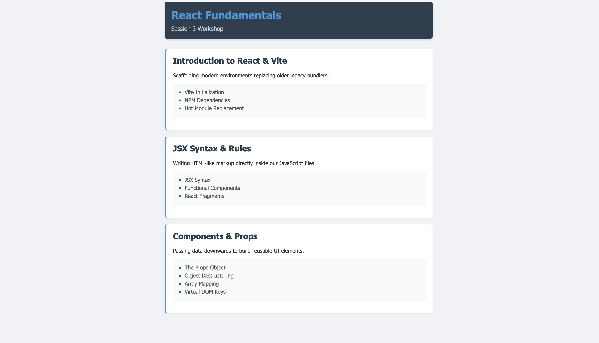

# Module 02 Devlog

## Proof of Completion

Provide a minimum of two screenshots OR one short GIF (under 10 seconds) demonstrating the completed work running in your Codespace.


Figure 1: PlayerProfile component using React state, the spread operator, and the Gain XP event handler.


Figure 2: Application running in the browser showing the player's rank, online status, and the Gain XP button after being clicked a few times.

**Extension task completed successfully:** [Yes]

**Briefly describe what is happening in the media:**  

Figure 1 shows the PlayerProfile component using useState, object destructuring and the spread operator to update the player's level without mutating the original object. Figure 2 shows the app running in the browser, with the rank text (Novice/Adept/Master) changing as the level increases from clicking Gain XP.

## Concept Mapping

Identify the specific theoretical concepts from this week's lectures that you applied to solve the practical work for this week.

- **Concept 1:** [Slide 5] — [Virtual DOM Concept]
  - **Implementation:** I used React state (`useState`) to store the player object. When the Gain XP button is clicked, I create a new copy of the object with the spread operator instead of editing the original, so React can detect the change and update the interface.

  Code snippet:
  ```JSX
  const handleLevelUp = () => {
    const updatedPlayer = { ...player, level: level + 1 };
    setPlayer(updatedPlayer);
  };
  ```

- **Concept 2:** [Slide 20] — [Component Fragments]
  - **Implementation:** I wrapped the return statement in a Fragment (`<></>`) instead of adding an extra `<div>`, so multiple elements can be returned without creating an unnecessary DOM node.

  Code snippet:
  ```JSX
  return (
    <>
      <div className="profile-card">
        <h2>Player: {username}</h2>
        <p>Rank: {getPlayerRank(level)}</p>
        <button onClick={handleLevelUp}>Gain XP</button>
        {active ? <p>Status: Online</p> : <p>Status: Offline</p>}
      </div>
    </>
  );
  ```

## AI Transparency and Critical Reflection

Detail how Generative AI was used during this lab.

**Table 1: AI Tool Usage Log**

| AI tool used | Purpose | Prompt used | Did you use the output "as is" or modify it? How? |
| :--- | :--- | :--- | :--- |
| Claude | Debugging a blank page | Asked why the page was blank and provided the Vite error showing it couldn't resolve `./components/PlayerProfile.jsx` | Modified: found that my `components` folder was spelled `Compoents`, then renamed the folder myself. |
| Claude | Debugging the dev server not starting | Pasted the terminal error `ENOENT: no such file or directory, open '.../package.json'` | Modified: learned I needed to `cd tutorials/t02` before running `npm run dev`, then ran the correct commands myself. |

## Analysis and Implications

AI developed my understanding of React concepts such as spread operators, it also helped me with silly mistakes such as why the page was staying blank and changing the directory to make the server start. AI did not reduce the understanding of the core concepts rather it provided more insight and understanding of the core concepts. I can also see the implications in the work force as if this was to be used more and more in workplaces, there could be security issues as some infomation would need to be kept private and goverments and private companies may want to keep things classified, we also do not know whether the code could be having implications of itself and maybe it has its own vulnerabilities which if people chose to copy blindly would result in data being leaked including people's personal information.


**Reflection:**  

This module taught me about React and how it uses components and state to build interacter interfaces. at the start i found the spread operator a bit confusing inscluding the destructuring, but by the time i finished task 5. It developed my understanding and that using player to copy the object before changing a value is what lets React see the update, rather than just changing data it did not actually see change. I also learned how event handlers and conditional renering lets the UI respond directly to the user interaction, this can be seen as the health warning appeared once teh health dropped to 40.


# Module 03 Devlog

## Proof of Completion


Figure 1 Showing the application running in the browser showing the Header and three CourseModule cards rendered from the moduleData array, each with a nested topics list.



Figure 2 App.jsx using array .map() with a key prop to render a CourseModule for each object in moduleData.

**Extension task completed successfully** - Yes

**Briefly describe what is happening in the media**  

Figure 1 shows the t03 application in the browser, with the Header component at the top and three CourseModule cards below it, each showing a title, description, and a bulleted list of topics. Figure 2 shows the App.jsx code responsible for generating those cards dynamically from an array of module objects, rather than hardcoding each one individually.

## Concept Mapping

Identify the specific theoretical concepts from this week's lectures that you applied to solve the practical work for this week.

- **Concept 1** (Slide 11) — (The Core of React Components)
- **Implementation** I split the interface into separate reusable components (Header.jsx and CourseModule.jsx) instead of writing everything directly inside App.jsx, so each piece of the UI is isolated and can be reused or tested independently.

  Code snippet

  ```JSX
  function Header() {
    return (
      <header className="app-header">
        <h1>React Fundamentals</h1>
        <p>Session 3 Workshop</p>
      </header>
    );
  }

  export default Header;
  ```

- **Concept 2** (Slide 25) — (Passing and Using Props)
- **Implementation** I passed title, description, and topics from App.jsx down into CourseModule as props, and used object destructuring in the function signature to access them directly instead of writing props.title everywhere.

  Code snippet

  ```JSX
  function CourseModule({ title, description, topics = [] }) {
    return (
      <div className="module-card">
        <h2>{title}</h2>
        <p>{description}</p>
      </div>
    );
  }
  ```


## AI Transparency and Critical Reflection

Detail how Generative AI was used during this lab.

**Table 1 AI Tool Usage Log**

| AI tool used | Purpose | Prompt used | Did you use the output "as is" or modify it? How? |
| --- | --- | --- | --- |
| Claude | Debugging the dev server not starting | Pasted the terminal error `ENOENT no such file or directory, open '.../package.json'` |  learned I needed to `cd tutorials/t03` before running `npm run dev`, then ran the correct commands myself. |
| Claude | Confirming a blank white page was expected, not a bug | Asked why the page was blank after setting up App.jsx with just an empty div | confirmed this was the correct result at that stage of the tutorial, so no code changes were needed. |

## Analysis and Implications

**Reflection**  

AI helped me effectively identify the issues going wrong in this mdoule like the ENOENT directory issue and the Vite import error. This helped save time compared to if i was to search through it by myself. I also made sure to understadn why each fix worked, like how the dev server needs to run from inside the project folder, and not just just the repo root. I do not believe it has obstructed my understanding of the core concepts, especially as AI was mainly used for debugging rather than writing the logic itself. I still needed to understand the concepts like props, and .map() well enough to apply them and explain them in this devlog.

This module taught me how React Breaks an interface down into separate components instead of one large file. At the start i found passing props between components a bit confusing, but when I had to build the CourseModule, it got it clicking in my head. I also learned how to .map() with a key prop and how default values can stop a component from breaking if a parent forgets to pass something.