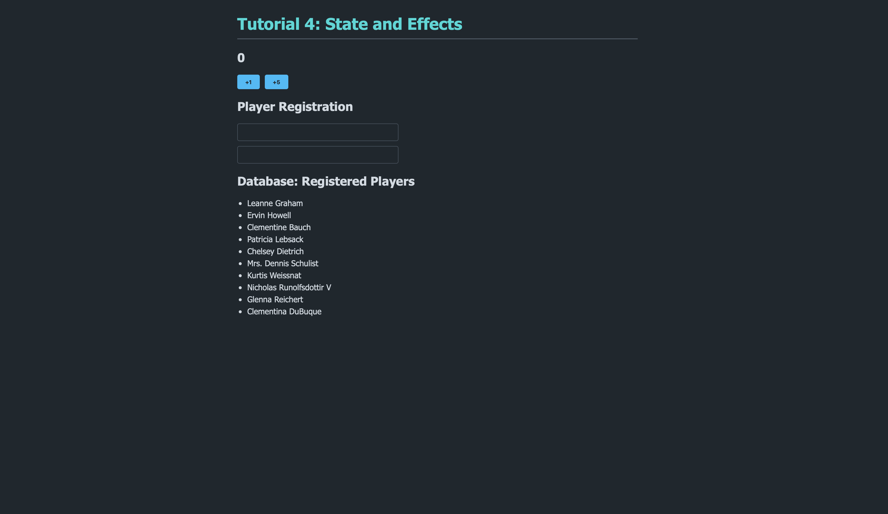
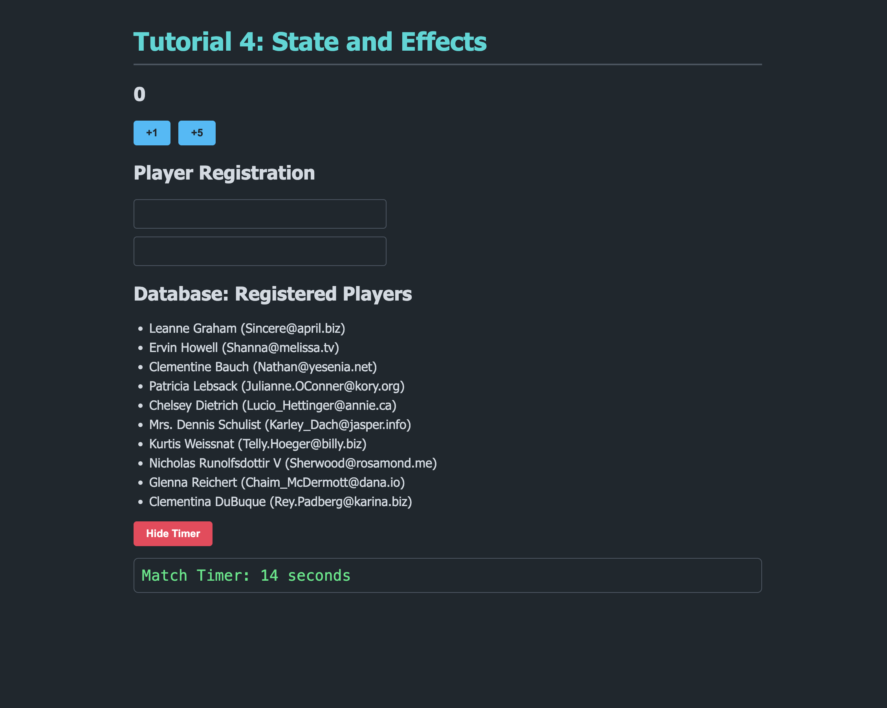
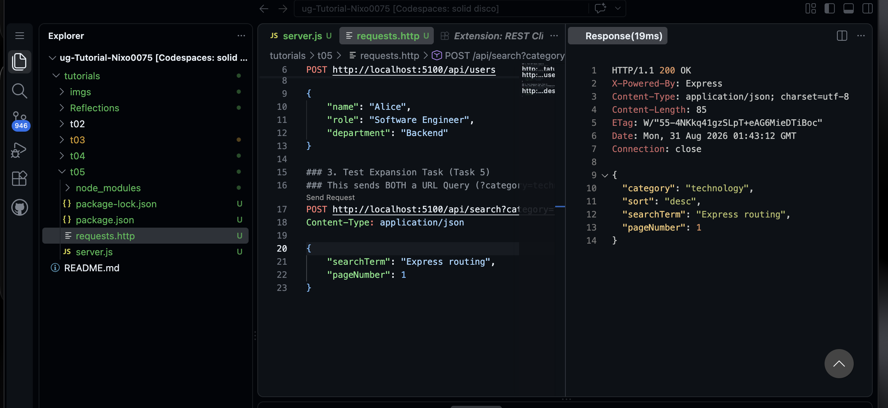
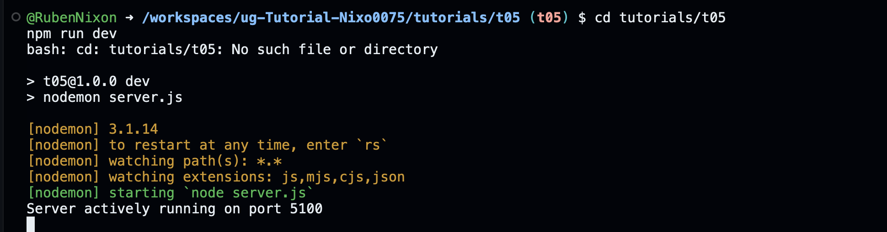

# Module 04 Devlog

## Proof of Completion

Provide a minimum of two screenshots OR one short GIF (under 10 seconds) demonstrating the completed work running in your Codespace.



Figure 1 The t04 application running in the browser, showing the Tutorial 4 heading, the ScoreBoard with its +1/+5 buttons, the Player Registration form, and the list of users retrieved from the dummy database endpoint.



Figure 2 LiveClock.jsx showing the useState seconds counter, the setInterval inside useEffect, and the returned cleanup function that calls clearInterval.

**Extension task completed successfully** [Yes]

**Briefly describe what is happening in the media**

Figure 1 shows the finished t04 app with all four components mounted togetherm ScoreBoard the state + functional updates, UserForm the controlled inputs bound to a single state object, and DataFetcher which gets data pulled from an external API using useEffect. 

Figure 2 shows the LiveClock component, which uses setInterval to increment a seconds counter every 1000ms, and a cleanup function to clear the interval when the component unmounts, which is triggered by a Hide/Show Timer toggle button in App.jsx.

## Concept Mapping

Identify the specific theoretical concepts from this week's lectures that you applied to solve the practical work for this week.

- **Concept 1** React Hooks — State and Functional Updates
  - **Implementation** I used useState in ScoreBoard.jsx to give the component memory. For the increment function I updated state directly off the current value, but for plusFive I used the functional update form (prevScore => prevScore + 5) so the update is calculated from the most recent state rather than a stale value captured at render time, avoiding issues with React batching multiple state updates together.

  Code snippet
  ```JSX
  const plusFive = () => {
    setScore((prevScore) => prevScore + 5);
  };
  ```

- **Concept 2** Side Effects and Cleanup with useEffect

  - **Implementation** In LiveClock.jsx I used useEffect with an empty dependency array so the timer only starts once, when the component mounts. I returned a cleanup function from the effect that calls clearInterval, so that if the component is removed from the screen (via the Hide Timer toggle in App.jsx) the interval is destroyed instead of continuing to run in the background and causing a memory leak.

  Code snippet
  ```JSX
  useEffect(() => {
    const intervalId = setInterval(() => {
      setSeconds((prev) => prev + 1);
    }, 1000);

    return () => {
      clearInterval(intervalId);
    };
  }, []);
  ```

## AI Transparency and Critical Reflection

Detail how Generative AI was used during this lab.

**Table 1 AI Tool Usage Log**

| AI tool used | Purpose | Prompt used | Did you use the output "as is" or modify it? How? |
| --- | --- | --- | --- |
| Claude | Debugging npm run dev not starting | Pasted the terminal error ls cannot access 'src/' No such file or directory and the ENOENT package.json error | Modified learned I was in the repo root instead of tutorials/t04, used find . -maxdepth 3 -name package.json to locate the project, then cd'd in myself. |
| Claude | Reviewing my components folder structure | Shared terminal output showing ls src/ after creating the components folder | Modified Claude noticed my folder was named Components (capital C) instead of components, explained that Linux filesystems are case-sensitive so this could break future imports, and I renamed it myself with mv src/Components src/components. |

## Analysis and Implications

AI helped me catch small but important mistakes early, like the capitalised folder name and being in the wrong directory, which would have caused confusing errors later on if left unfixed. It also helped me understand *why* the functional update form of setScore was necessary rather than just telling me to use it, which made the batching concept from the lecture make more sense in practice. AI did not write the logic for me, it mainly acted as a debugger and explainer, so I still had to understand useState, useEffect, spread syntax and computed property names well enough to apply them myself. I think there are implications for relying on AI in professional settings too, particularly around trusting AI output uncritically. In this task Claude actually got the initial App.jsx wrong because it assumed an older template, which shows why it's important to verify AI-generated code against the actual environment and version you are working with, rather than copying it blindly.


---

# Module 05 Devlog
## Proof of Completion


Figure 1 The REST Client response panel in VS Code showing HTTP/1.1 200 OK after sending the POST request to /api/search?category=technology, with the echoed category, sort, searchTerm, and pageNumber fields.


Figure 2 Terminal output confirming the t05 server was started successfully via nodemon and is actively running on port 5100.

**Extension task completed successfully** - Yes

**Briefly describe what is happening in the media**
Figure 1 shows the response from testing the POST /api/search route via the requests.http file, confirming the server correctly parsed both the URL query string and the JSON request body, combining category, sort, searchTerm, and pageNumber into a single 200 OK response. Figure 2 shows the server running successfully via nodemon on port 5100, confirming the routes (including the /api/search extension task) were live and reachable for testing.

## Concept Mapping

Identify the specific theoretical concepts from this week's lectures that you applied to solve the practical work for this week.

- **Concept 1** (Client-Server Request/Response Cycle)
- **Implementation** I built three Express routes that each handle a different combination of HTTP method and data source a GET route that just returns server status, a POST route that reads req.body (parsed by the express.json() middleware), and a POST route that reads both req.query (from the URL) and req.body at the same time, combining them with the spread operator before sending the response.

  Code snippet

  ```JS
  app.post('/api/search', (req, res) => {
    const queryParams = req.query;
    const bodyData = req.body;

    const combinedResult = {
      ...queryParams,
      ...bodyData
    };

    res.status(200).json(combinedResult);
  });
  ```

- **Concept 2** (Middleware and HTTP Status Codes)
- **Implementation** I registered express.json() as middleware before defining any routes, so that incoming JSON bodies are parsed and made available on req.body before my route handlers run. I also used the correct status codes for each route 200 for a successful GET/search response, and 201 specifically for the POST route that creates a new user resource.

  Code snippet

  ```JS
  app.use(express.json());

  app.post('/api/users', (req, res) => {
    const incomingData = req.body;

    res.status(201).json({
      message "User successfully created",
      data incomingData
    });
  });
  ```

## AI Transparency and Critical Reflection

Detail how Generative AI was used during this lab.

**Table 1 AI Tool Usage Log**

| AI tool used | Purpose | Prompt used | Did you use the output "as is" or modify it? How? |
| --- | --- | --- | --- |
| Claude | Debugging why npm run dev couldn't find package.json | Pasted the same ENOENT error as in earlier modules | Modified confirmed I needed to cd tutorials/t05 first, then ran the setup commands myself. |
| Claude | Debugging repeated "Cannot GET" errors when testing the POST route | Pasted screenshots and messages showing I was opening the forwarded Codespace URL in Chrome and Cmd+clicking the URL inside requests.http | Modified Claude explained that a browser can only ever send a GET request when a link is clicked, and that I needed to use the REST Client extension's "Send Request" CodeLens inside the editor instead of Cmd+clicking the URL. I located the correct link and used it myself. |
| Claude | Debugging requests.http not being found by cat | Pasted terminal output showing cat requests.http No such file or directory` | Modified worked through with Claude that my terminal was still occupied by the running nodemon process, so my later commands were never actually executed. Claude suggested opening a second terminal, after which I recreated the file directly in the VS Code editor myself. |


## Analysis and Implications

AI was most useful in this module for undertanding terminal and tooling issues rather than the Express concepts themselves, for example realising that a running nodemon process occupies the terminal so no other commands run until it's stopped or a new terminal is opened, and that clicking a URL (even inside a .http file) always sends a GET request in a browser regardless of what method is written next to it. I had to actually understand the difference between req.query and req.body, and why middleware order matters, to write the /api/search route correctly, so AI acted more as a debugger and proofreader here than as something that wrote the logic for me.


